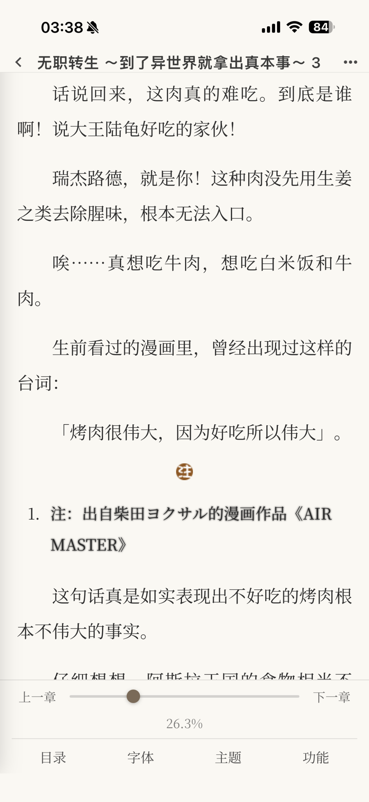

# 岛上书店

一个为**长篇小说**做的本地 EPUB 阅读器。Android / iOS 双端，Flutter 实现。

不是又一个「能打开 epub」的阅读器，而是把几个具体到影响阅读体验的问题真正解决掉：打开书时页面不跳、进度恢复精确到字、繁简转换后位置不丢、精排书的字体能正常加载。

> 个人自用项目，持续打磨中。31 个 Dart 文件，约 7300 行。

<p align="center">
  
  &nbsp;&nbsp;&nbsp;
  
</p>

---

## 解决的几个具体问题

大部分阅读器能打开 epub，但在下面这些地方会打折扣。这个项目针对性地做了处理：

| 问题 | 常见表现 | 这里的做法 |
|---|---|---|
| **打开书时页面乱跳** | 图片没加载完，高度从 0 变成实际值，正文被顶飞 | 导入时把图片宽高比写进 `style="aspect-ratio:..."`，布局在图片解码前就是最终高度 |
| **进度恢复不准** | 下次打开差几百字，读几本后越漂越远 | 存「章节序号 + 段落内字符偏移」，不用百分比兜底；两端用同一套偏移算法 |
| **繁简转换后定位失效** | 转成繁体后再打开，位置全错 | 坐标一律按**原文字符数**累加，显示层做偏移映射，转换不影响定位 |
| **字体设置不生效** | 换了字体没反应，永远是黑体 | epub 自带的 CSS 常在 `div`/`p` 上写死 `font-family`，强制 `inherit` 让设置生效 |
| **带字体混淆的书打不开** | 提示有 DRM，或被拒 | 区分「字体混淆」和真 DRM，并对混淆字体做还原 |

---

## 功能

### 阅读

- **滚动阅读**，没有翻页动画，点一下直接进正文
- **精确进度**：章节 + 字符偏移，退出重进误差在个位数像素
- **繁简实时转换**：短语级词典（`頭髮` / `乾杯` / `為什麼`），不是单字硬替换
- **内置字体**：思源宋体（24MB）、汉仪闲情（12MB）、思源文楷（5.6MB），随包分发，不依赖系统字体
- **可调排版**：字号、行距、段间距、页边距、背景主题
- **长按选词**：高亮 / 笔记 / 复制 /（iOS 走系统翻译）
- **书签**：右侧区域向左滑即可加/删，不用进菜单
- **沉浸式 HUD**：顶栏书名 + 底栏进度条，可拖动跳转

### 书库

- **导入 `.epub`**，自动解析目录、封面、简介
- **多级分组**：分组可以放在书籍上方或下方，**按层级独立保存**
- **三种排序**：最近阅读 / 文件名（自然排序，第2卷在第10卷前）/ 手动拖拽
- **封面自定义**：可从相册选图
- **局域网传书**：手机开一个 HTTP 服务，电脑浏览器打开地址就能拖 epub 进去，不用数据线

### 文本修改

- **查找替换**：全书 / 本章 / 此处三种范围，直接改 `index.html`，永久生效
- **临时规则**：只改显示不落盘，适合试效果

---

## 技术选型

| 关注点 | 选择 | 为什么 |
|---|---|---|
| UI | Flutter 3.47 / Dart 3.13 | 一套代码双端，自绘 UI 控制力强 |
| 正文渲染 | `webview_flutter`（官方） | 用 HTML/CSS 渲染 epub 最省事，`flutter_inappwebview` 用了已废弃的 AGP 配置会编译失败 |
| 本地存储 | `sqflite` | 书、分组、章节、书签、笔记、进度、规则，关系型更清晰 |
| zip | `archive` | epub 本质是 zip，只解压 manifest 引用到的文件（有些书塞了几十 MB 垃圾数据） |
| XML | `xml` | 解析 OPF / NCX / container |
| 字体还原 | `crypto` | 字体混淆要用 SHA1 算 key |

### 目录结构

```
lib/
├── core/          沙盒路径解析、主题配色
├── data/
│   ├── db/        SQLite 建表与迁移
│   ├── models/    Book / BookGroup / Chapter / Bookmark / Note / TextRule
│   └── repositories/
├── features/
│   ├── bookshelf/ 书架、分组、手动排序、批量操作
│   ├── detail/    书籍详情、分组详情、封面操作
│   └── reader/    阅读页（WebView 宿主）
├── services/
│   ├── epub/      OPF/NCX 解析、资源提取、字体解混淆
│   ├── import/    导入流程
│   ├── render/    index.html 生成、CSS 注入、文本修改
│   └── lan/       局域网传书 HTTP 服务
└── widgets/       自定义图标
assets/
├── fonts/         内置字体（41MB）
└── reader/        reader.css + reader.js（引擎侧逻辑）
```

阅读引擎的相当一部分逻辑在 `assets/reader/reader.js` 里：手势、位置捕获/恢复、繁简转换、书签、HUD 状态。App 启动时会把它同步到每本书的目录，所以引擎侧的修复对老书也生效，不用重新导入。

---

## 构建

### Android

```bash
flutter pub get
./build.sh            # debug APK
./build.sh release    # release APK
```

`build.sh` 处理了三个环境问题：走国内镜像、`PUB_CACHE` 挪到英文路径（中文用户名会让 ninja 编不了 C++）、`android.overridePathCheck`（项目路径含中文）。

### iOS

项目用 **Swift Package Manager** 集成（不是 CocoaPods，没有 Podfile），需要 Xcode 15+。

```bash
flutter pub get
open ios/Runner.xcworkspace
# 在 Xcode 里设置签名 Team，bundle id 是 com.islandbooks.islandBooks
```

如果手边只有 Windows，仓库里带了 GitHub Actions 工作流（`.github/workflows/build-ios.yml`）：

```
push tag → macOS runner 编译（--no-codesign）→ 打包 unsigned IPA → artifact 下载
```

拿到未签名 IPA 后，用 Sideloadly / AltStore 自行签名安装即可。

---

## 几个踩过的坑

记在这里，免得重复踩。

**1. `META-INF/encryption.xml` 存在 ≠ 有 DRM**

EPUB 规范允许用这个文件声明「字体混淆」（IDPF / Adobe 两种算法）。这类书正文完全是明文，只是内嵌字体被 XOR 了一下。早期版本只要看到这个文件就拒绝，把大量正常书挡在门外。

正确做法是解析 `<EncryptionMethod Algorithm="...">` 的值：

```
http://www.idpf.org/2008/embedding    → IDPF 字体混淆，可读
http://ns.adobe.com/pdf/enc#RC       → Adobe 字体混淆，可读
其它（LCP / ADEPT）                  → 真 DRM
```

顺带一个细节：标签通常带命名空间前缀（`<enc:EncryptionMethod>`），正则不写 `(?:[\w.-]+:)?` 就永远匹配不上。

**2. Adobe 的字体混淆 key 不走 SHA1**

| 算法 | key | XOR 长度 |
|---|---|---|
| IDPF | `SHA1(unique-identifier)` | 前 1040 字节 |
| Adobe | `unique-identifier` 里 UUID 的 **16 字节**（hex 解码） | 前 1024 字节 |

试了 7 种组合才确认 Adobe 是直接用 UUID 字节，不是哈希。解出来的字体头应该是 `00 01 00 00` 或 `OTTO`，用这个做校验，解错就不写盘。

**3. iOS 沙盒路径每次安装都会变**

```
/var/mobile/Containers/Data/Application/<UUID>/Documents/books/...
                                              ↑ 这个 UUID 重装就变
```

数据库里如果存绝对路径，重装后所有书都会显示「文件缺失」——文件其实还在，只是路径对不上。现在统一按「当前沙盒 + `books/...`」重新拼。

**4. 繁简转换会破坏所有基于字符的位置**

转换后 `頭髮` 变 `头发`，字符数可能变，之前存的偏移全错位。解法是坐标一律用**原文字符数**：DOM 里插入的每个 span 都带原文长度，定位时累加原文长度，显示时再把偏移映射回去。

**5. 拖进度条会误加书签**

正文的手势判断里有一条「从屏幕右侧 55%~88% 起手向左滑 = 切换书签」。进度条正好在底部横跨这段区域，拖动时会触发。现在工具栏内的手势不参与正文判断。

---

## 状态

个人自用，功能基本完整。已知的不足：

- 章节不是懒加载，超长篇（5000+ 节点）首次渲染约 500ms
- `reader.js` 约 470KB，主要是繁简词表
- 网格视图的分组和书籍是分段的，不支持混排
- 只支持 EPUB，不支持 TXT / MOBI / PDF

---

## 许可

个人项目，代码参考随意，不提供任何担保。请只导入你有权阅读的内容。
